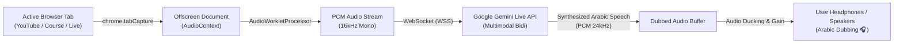

<div align="center">

# 🎙️ Gemini Live Dubbing Extension
### **Real-Time Tab Audio Translation & Dubbing into Arabic via Google Gemini Live API**
#### **إضافة كروم للدبلجة الصوتية اللحظية والمباشرة إلى اللغة العربية عبر ذكاء Gemini الاصطناعي**

[](https://developer.chrome.com/docs/extensions/mv3/intro/)
[](https://ai.google.dev/)
[](https://developer.mozilla.org/en-US/docs/Web/API/Web_Audio_API)
[](LICENSE)
[](https://github.com/Eng0Ahmed/Gemini-Live-Dubbing-Extension/releases)

<br/>


</div>

---

## 🌟 Overview / نظرة عامة

### English:
**Gemini Live Dubbing Extension** is an innovative, high-performance Google Chrome extension (Manifest V3) designed to translate and dub audio streams in real time from any active browser tab (YouTube videos, educational courses, live podcasts, foreign conferences) directly into **Fluent Classical Arabic (العربية الفصيحة)**.

Powered by **Google Gemini Live API** over a full-duplex `WebSocket` connection combined with Chrome's **Web Audio API & AudioWorklet**, the extension delivers near-instantaneous speech-to-speech dubbing with human-like vocal quality and natural inflection.

### العربية:
**إضافة دبلجة Gemini Live المباشرة** هي إضافة ثورية لمتصفح جوجل كروم (بأحدث معايير Manifest V3) تقوم بالتقاط تدفق الصوت المباشر من أي تبويبة نشطة في المتصفح (فيديوهات يوتيوب، الكورسات التعليمية، البث المباشر، أو اللقاءات بأي لغة كانت)، ومعالجته بتقنيات **Web Audio API & AudioWorklet**، ثم إرساله عبر اتصال `WebSocket` لحظي ثنائي الاتجاه إلى **Google Gemini Live API** لدبلجته وترجمته فورياً إلى **اللغة العربية الفصيحة** بصوت بشري متناغم وسريع الاستجابة.

---

## ✨ Key Features / أهم المميزات

| Feature | Description |
| :--- | :--- |
| ⚡ **Ultra-Low Latency** | Instantaneous streaming dubbing (~120ms response time) with zero perceptible lag. |
| 🌍 **Universal Language Support** | Ingests English, French, Spanish, German, Japanese, and any foreign language, outputting pure Arabic. |
| 🤖 **Adaptive Tone & Voice Cloning** | Automatically detects the speaker's vocal characteristics (gender, tone, emotion) and reflects them in the dubbed speech. |
| 🎛️ **Independent Volume & Ducking** | Dual audio balance: boost dubbed speech up to **150%** while selectively lowering original audio (**Ducking**) or muting it completely. |
| 📊 **Live Telemetry & Visualizer** | Real-time audio waveform visualizer, session timer, connection status indicator, and frame meters. |
| 🎙️ **Vocal Clarity Filters** | Preset equalizer enhancements: `Vocal Boost` (clarity), `Noise Gate` (noise reduction), and `Flat` (natural output). |
| 🔒 **Privacy & Direct Connection** | Direct client-to-API communication; your audio is processed directly through Google's official endpoints with your own API key. |

---

## 🏗️ Architecture & Pipeline / آلية العمل وهندسة البيانات



---

## 📂 Project Structure / هيكل المشروع

```
Gemini-Live-Dubbing-Extension/
├── manifest.json              # Chrome Extension MV3 Metadata & Permissions
├── assets/                    # Application icons & graphics
│   ├── icon16.png
│   ├── icon48.png
│   └── icon128.png
├── background/
│   └── background.js          # Service worker managing tabs & offscreen lifecycle
├── offscreen/                 # Dedicated offscreen document for Web Audio
│   ├── offscreen.html
│   ├── offscreen.js           # WebSocket connection & Gemini Live audio streaming
│   └── audio-processor.js     # Low-latency AudioWorklet PCM processing
├── popup/                     # User interface dashboard
│   ├── popup.html             # UI layout & telemetry display
│   ├── popup.css              # Modern cyberpunk dark theme
│   └── popup.js               # Reactive controls, settings & visualizer
├── .github/workflows/         # Automated CI/CD packaging
│   └── package-extension.yml
├── .gitignore
├── LICENSE                    # MIT License
└── README.md                  # Comprehensive Documentation
```

---

## 🚀 Installation & Setup / خطوات التثبيت والتشغيل

### Method 1: Load as Unpacked Extension (Recommended for Developers)
1. Clone this repository to your machine:
   ```bash
   git clone https://github.com/Eng0Ahmed/Gemini-Live-Dubbing-Extension.git
   ```
2. Open Google Chrome or Microsoft Edge and navigate to:
   - Chrome: `chrome://extensions/`
   - Edge: `edge://extensions/`
3. Enable **Developer mode** toggle in the top-right corner.
4. Click **Load unpacked** (تحميل إضافة تم فك ضغطها) and select the `Gemini-Live-Dubbing-Extension` root folder.
5. The extension icon will now appear in your browser toolbar!

### Method 2: Download Ready-to-Use Zip from Releases
1. Go to the [Releases](https://github.com/Eng0Ahmed/Gemini-Live-Dubbing-Extension/releases) page.
2. Download the latest `Gemini_Dubbing_Extension.zip` package.
3. Extract the `.zip` archive on your computer.
4. In `chrome://extensions/`, enable **Developer mode**, click **Load unpacked**, and choose the extracted folder.

---

## 🔑 Getting Your Free Google Gemini API Key

1. Visit [Google AI Studio](https://aistudio.google.com/app/apikey).
2. Sign in with your Google account.
3. Click **Create API Key**.
4. Copy the generated key.
5. Click on the extension icon in Chrome, paste your key into the **API Key** input, and it will be saved securely in your browser's local storage for future sessions.

---

## 🎧 How to Use / طريقة الاستخدام

1. Open any web page with audio/video (e.g., YouTube video, Coursera lecture, French documentary).
2. Click the **Gemini Live Dubbing** icon in your Chrome extensions bar.
3. Configure your preferences:
   - **Audio Mode:** Duck Original Audio (خفض صوت المصدر) or Mute Original (كتم الصوت الأصلي).
   - **Dubbed Volume:** Adjust the slider to your preferred listening volume.
4. Click **▶ بدء الدبلجة التلقائية المباشرة (Start Live Dubbing)**.
5. Enjoy real-time, high-fidelity Arabic voice dubbing directly in your ears!

---

## 👤 Developer / عن المطور

Developed with ❤️ by **Eng. Ahmed Abdelaziz**

- 📧 **Email:** [eng.ahmed.abdelaziz.2022@gmail.com](mailto:eng.ahmed.abdelaziz.2022@gmail.com)
- 💬 **WhatsApp:** [+201024735044](https://wa.me/201024735044)
- 🐙 **GitHub:** [@Eng0Ahmed](https://github.com/Eng0Ahmed)

---

## 📜 License

This project is licensed under the **MIT License** - see the [LICENSE](LICENSE) file for details.
Feel free to star ⭐ the repository if you find it helpful!
